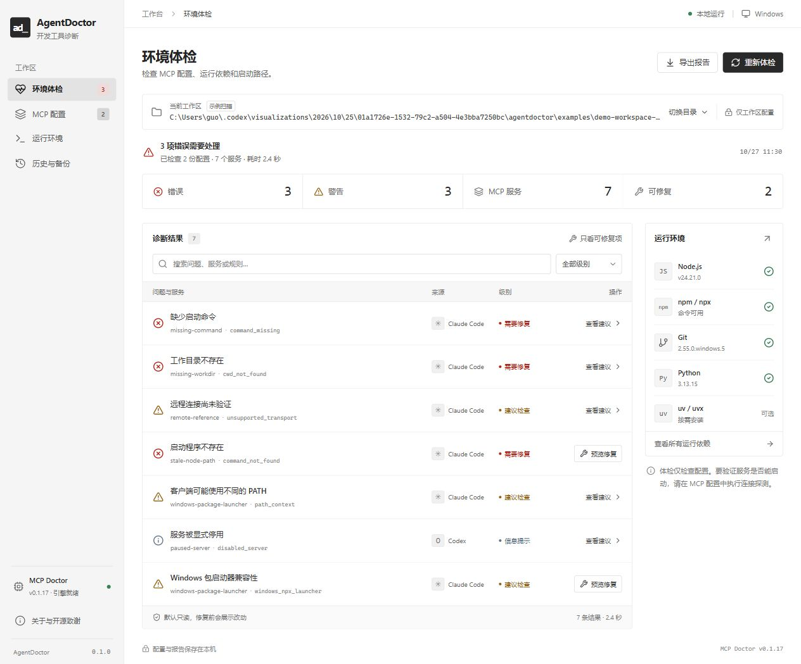

# AgentDoctor

[简体中文使用说明](README.zh-CN.md)

[Download Windows x64](https://github.com/kylinwel/agentdoctor/releases/tag/v0.1.0) · [Report a bug](https://github.com/kylinwel/agentdoctor/issues) · [Contributing](CONTRIBUTING.md)

A local-first Windows workbench for diagnosing AI development environments and making reviewable, reversible MCP configuration repairs.

**中文界面 · 本地运行 · 无需 API Key · MIT**

AgentDoctor **reuses the unmodified [MCP Doctor](https://github.com/Tinkora/mcp_doctor) v0.1.17 engine**, rather than rebuilding its diagnostic rules. It adds a desktop UI, environment inventory, conservative repair plans, original-file backups, rechecks, scrubbed reports and explicit local MCP probes.

## Quick start

**Windows portable:** download `AgentDoctor-0.1.0-win-x64.zip` from [Releases](https://github.com/kylinwel/agentdoctor/releases/tag/v0.1.0), extract the entire folder and open `AgentDoctor.exe`. Opening the desktop workbench does not require Node.js. This first preview is unsigned.

For source development:

~~~powershell
git clone https://github.com/kylinwel/agentdoctor.git
cd agentdoctor
~~~

Requirements: Node.js 22.12+ (Node.js 24 LTS recommended), Windows x64 for the first desktop release.

Run the browser edition:

~~~powershell
npm ci --ignore-scripts
npm run setup:engine
npm run build
npm start
~~~

Open http://127.0.0.1:4318.

The project uses npm's platform esbuild package. If your installation specifically requires its postinstall step, review the installed esbuild package and run its official installer. No arbitrary MCP server is started during setup or scanning.

For the desktop edition:

~~~powershell
npm run setup:desktop
npm run desktop
~~~

The setup scripts download official GitHub release assets and verify their SHA-256 digests. Downloading may require the network/proxy configuration appropriate for your environment. Node.js 24 supports --use-env-proxy; do not put proxy credentials into source files.

Alternatively double-click **Start-AgentDoctor.cmd**. It uses the existing local dependencies and built UI; it does not silently install packages.

## Features

- Automatic discovery of common workspace and user MCP config paths for Claude Code/Desktop, Cursor, Codex, VS Code, Copilot CLI and Cline.
- JSON, JSONC and TOML static diagnosis powered by the pinned MCP Doctor Rust binary.
- Current-process executable discovery for Node.js, npm, Git, Python, uv, Bun and AI CLIs.
- Missing or stale command paths, missing working directories, runtime prerequisites, scope/name conflicts, placeholders and unsupported transports.
- Conservative JSON/JSONC repairs using Microsoft's jsonc-parser: preserve comments, original formatting and unrelated settings.
- Preview the selected server's exact changes with environment values and recognized credentials redacted.
- Save and verify the complete original file before changes; detect stale previews and concurrent edits.
- Recheck after applying a repair. Restore refuses to overwrite later user edits.
- Explicit MCP initialize/tools-list probes for existing local Node/Python scripts using the official MCP SDK. No tools are called.
- Export JSON or Markdown reports with common credentials, environment values, home paths and email addresses scrubbed.
- Dedicated example workspace, scanned by the **real engine**, so repair and rollback can be tried without changing real client configs.

## First use

1. Launch the app and select a project directory.
2. Choose whether to include the current user's standard config paths.
3. Run a read-only scan and expand findings to inspect evidence.
4. For supported repairs, select **预览修复**, review the diff, then **备份并应用修复**.
5. Review the automatic recheck. Original backups are under **历史与备份**.
6. To test a compatible local script, open **MCP 配置 → 连接探测**, review the displayed executable, arguments and working directory, then explicitly start the probe.

A static pass is **not** proof that a client can launch the server or that its tools function correctly.

## First-release boundaries

- JSON/JSONC supports automatic repair. TOML is currently read-only.
- Automatic fixes cover recognized stale/bare runtime paths and the Windows npx launcher path where the installed npm script can be identified.
- Windows npx repairs invoke the existing npm npx-cli.js with an absolute Node path, preserving arguments and avoiding cmd shell interpolation.
- Probes support existing Node/Python script files only. Shell commands, inline code, package download launchers, unresolved placeholders and remote transports are not probed.
- Optional tools missing from PATH are informational, not failures.
- Runtime version inspection launches only fixed --version requests for recognized runtimes. It never starts configured MCP servers.
- The app does not install runtimes, change global PATH/proxy settings, repair authentication, or claim to know which server package a missing arbitrary command should use.
- A probe is process execution, not a sandbox. Starting a server may itself perform work. Only probe servers you trust.
- Credential scrubbing covers recognized patterns and values in parsed config environment/credential fields. Review exported reports before publishing unusual or custom sensitive data.
- An older backup may conflict with newer repairs or user edits. Restore then refuses overwrite; the original backup remains available.

## Local data

Browser edition: .agentdoctor/ under the project directory.
Desktop edition: Electron's per-user app data directory, under state/.

- reports/: scrubbed diagnostic snapshots.
- backups/: original complete configuration bytes plus integrity manifests. **Backups can contain credentials**, remain local, and are never included in report exports or source packages.
- No telemetry, remote analytics or cloud account is used.
- The HTTP server binds only 127.0.0.1 and checks Host, Origin, JSON content type and a per-session token before mutations.

## Architecture

~~~text
React + Lucide UI / Electron desktop shell
                 |
      loopback Node.js API (per-session token)
                 |
      Doctor orchestration and evidence model
         /               |                 \
MCP Doctor CLI     jsonc-parser + diff     Official MCP SDK
static read-only   preview / backup / fix  explicit local probe
~~~

The upstream binary stays unmodified. See vendor/mcp-doctor/LICENSE and THIRD_PARTY_NOTICES.md.

## Development

~~~powershell
npm run dev
npm run check
~~~

Dev UI: http://127.0.0.1:5173. API: http://127.0.0.1:4318.

Tests use dedicated temporary files. They cover real upstream findings, no-execution scanning, JSONC preservation, scrubbed exports, stale-preview refusal, exact restore, post-repair edit conflicts, corrupted backups, local MCP handshakes and loopback API checks.

## Packaging

~~~powershell
npm run package:source
npm run package:windows
~~~

Source archive excludes dependencies, backups, reports, generated examples and test output.
The Windows portable package reuses the already verified Electron distribution, installs only locked production dependencies into its app directory, and includes the verified MCP Doctor engine and license.

## License

MIT. Third-party components retain their original licenses. This is an independent project, not an official MCP Doctor or AI client release.
